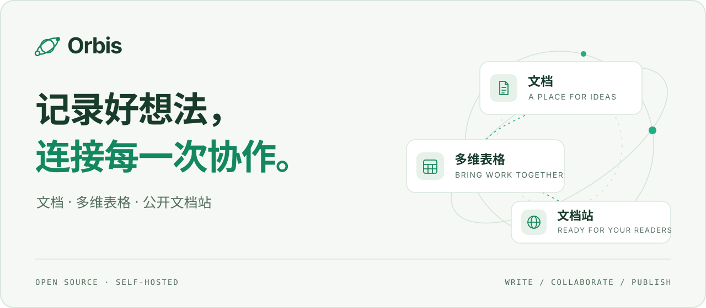

<p align="center">
  <picture>
    <source media="(prefers-color-scheme: dark)" srcset="docs/intro/assets/readme/hero-dark.svg">
    
  </picture>
</p>

<p align="center">
  <a href="https://github.com/singous/orbis/releases/tag/v0.1.0"></a>
  <a href="LICENSE"></a>
  <a href="deploy/README.md"></a>
  <a href="cli/README.md"></a>
</p>

<p align="center">
  <b>从个人记录，到团队协作，再到对外分享。</b><br>
  自托管的文档与知识空间，让内容的整理、编辑和发布在同一处完成。
</p>

<p align="center">
  <a href="#概览">概览</a> ·
  <a href="#功能">功能</a> ·
  <a href="#快速开始">快速开始</a> ·
  <a href="#cli-与-agent">CLI 与 Agent</a> ·
  <a href="#版本动态">版本动态</a> ·
  <a href="#文档导航">文档</a> ·
  <a href="#参与开发">开发</a>
</p>

## 概览

Orbis 将文集、块文档、多维表格和文档站放进同一个工作空间。用目录整理资料，用正文协同与评论一起完成内容，准备好后再发布给读者。

<table>
  <tr>
    <td width="33%" valign="top">
      <sub>01 / WRITE</sub><br>
      <b>写下与整理</b><br><br>
      从一页文档开始，用文集和嵌套目录组织内容；文字、表格、图片与绘图可以一起表达想法。
    </td>
    <td width="33%" valign="top">
      <sub>02 / COLLABORATE</sub><br>
      <b>一起完成</b><br><br>
      通过成员角色、正文协同、评论和历史恢复推进工作；用多维表格组织结构化信息。
    </td>
    <td width="33%" valign="top">
      <sub>03 / PUBLISH</sub><br>
      <b>准备好，再发布</b><br><br>
      将选定内容发布为文档站。发布版本拥有独立快照，团队继续编辑草稿时，读者看到的内容保持稳定。
    </td>
  </tr>
</table>

## 功能

| 场景 | 当前支持 |
| --- | --- |
| **组织知识** | 工作空间、文集分组、嵌套目录、搜索、Markdown 导入导出 |
| **丰富表达** | 块文档、富文本、普通表格、图片与附件、绘图、内容组件 |
| **团队协作** | 成员角色、邮件邀请、CRDT 正文协同、自动保存、评论、历史恢复 |
| **多维表格** | 字段、记录、视图、筛选、排序、分组、复制、撤销与 CSV/Markdown 导出 |
| **原生画板（开发分支）** | 流程图、思维导图、系统架构、UML、ER 与泳道图；114 种图形、24 个模板、6,283 个内置图标；图片、导入导出与正文引用 |
| **对外发布** | 文档站预览、固定快照、发布记录、版本切换与撤回、主题、移动端导航、公开搜索 |
| **工具接入** | 公共 API、工作空间范围的 Agent 令牌、独立 CLI、产品 Skill、持久化分块导入 |

**两种分享方式。** 文档站交付显式发布的快照；可撤销的实时分享展示当前可见内容，未来新增或移入的文档也可能进入分享范围。发布时私有文件会复制为发布专用对象；外部 HTTP(S) 媒体只固定 URL，不复制外部服务器的文件。

## 快速开始

### 自托管

v0.1.0 提供封版源码和通用 Docker Compose 模板。你需要 Docker Engine、Compose V2 和 Git；运行构建后的镜像无需在宿主机安装 Go 或 Node.js。

获取封版源码，构建服务端、前端和协同引擎镜像：

```bash
git clone --branch v0.1.0 https://github.com/singous/orbis.git
cd orbis

docker build --target server --build-arg ORBIS_VERSION=0.1.0 -t orbis-server:0.1.0 .
docker build --target frontend -t orbis-frontend:0.1.0 .
docker build --target collaboration -t orbis-collaboration:0.1.0 .

(umask 077; set -C; cat deploy/.env.example > deploy/.env)
```

按 [Compose 部署指南](deploy/README.md#首次安装) 填写 `deploy/.env`：为数据库、登录签名和协同引擎分别生成密钥，设置访问地址，并填入三个镜像的不可变引用。源码试用可通过 `docker image inspect --format '{{.Id}}' IMAGE` 取得本地镜像 ID。

配置完成后，仍在项目根目录执行：

```bash
docker compose --env-file deploy/.env -p orbis -f deploy/compose.yaml up -d --wait db redis
docker compose --env-file deploy/.env -p orbis -f deploy/compose.yaml --profile maintenance run --rm --no-deps migrate
docker compose --env-file deploy/.env -p orbis -f deploy/compose.yaml up -d --wait api web
```

本机试用时，将 `ORBIS_PUBLIC_BASE_URL` 设置为 `http://127.0.0.1:28190`，启动后访问 [初始化页面](http://127.0.0.1:28190/setup) 创建所有者账号。公开部署需按实际域名配置 HTTPS 和 WebSocket 反向代理。

升级已有实例请先阅读 [升级与备份说明](deploy/README.md#已有-go-版本升级与备份)，保留原有配置、密钥和持久化数据。

### CLI 与 Agent

独立 CLI 通过公共 API 访问服务，可用于文档读取、导入导出及结构化写入。产品 Skill 为 Agent 提供操作约定与示例。

```bash
make cli-build
bin/orbis --version
bin/orbis --help
```

从源码构建 CLI 需要 `.go-version` 固定的 Go 工具链。在工作空间的集成设置中生成专用令牌，再按 [CLI 指南](cli/README.md) 配置连接；令牌的权限范围与 Web 中的资源可见性保持一致。

[阅读 CLI 指南 →](cli/README.md) · [查看产品 Skill →](skills/orbis/SKILL.md) · [查看 API 契约 →](api/openapi.json)

## 版本动态

### v0.1.0 · 文档、协作与发布

首个封版版本串联文档整理、多人协作、多维表格和文档站发布，并交付独立 CLI 与自托管部署模板。

> [!NOTE]
> v0.1.0 的封版提交仍有浏览器端到端验收失败待处理。已完成的验证、使用边界和部署入口见 [版本说明](docs/release/v0.1.0.md)。

[阅读 Release Notes →](https://github.com/singous/orbis/releases/tag/v0.1.0)

**后续方向**：自定义域名、API 调试台、高级站点模板和 S3 存储适配尚未提供；独立 MCP 服务将在出现实际需求后建立。

## 文档导航

| 你想了解什么 | 文档 |
| --- | --- |
| 安装、配置、升级与备份 | [Docker Compose 部署](deploy/README.md) |
| 本地开发、架构与运行参数 | [开发与运行参考](docs/intro/development.md) |
| 协同引擎与内容恢复 | [协同引擎说明](collaboration/README.md) |
| 命令行与自动化接入 | [CLI](cli/README.md) · [产品 Skill](skills/orbis/SKILL.md) |
| 公共接口与数据格式 | [OpenAPI](api/openapi.json) |
| 版本范围与已知限制 | [v0.1.0 版本说明](docs/release/v0.1.0.md) |

## 参与开发

后端采用 Go、Gin、GORM 与 PostgreSQL，前端使用 React 和 TypeScript；正文协同采用 Yjs 和独立 Node.js 引擎。CLI 使用独立 Go module，通过公共 API 访问服务。

开发环境需要 `.go-version` 固定的 Go、Node.js 24 和 Docker。工作从 `develop` 分支开始，详细命令见 [本地开发](docs/intro/development.md#本地开发) 与 [验证](docs/intro/development.md#验证)。

问题反馈请提交 [Issue](https://github.com/singous/orbis/issues)，功能与修复通过面向 `develop` 的 PR 评审。

<details>
<summary>原 README 技术章节索引</summary>

<a id="架构与契约"></a>
[架构与契约](docs/intro/development.md#架构与契约)

<a id="本地开发"></a>
[本地开发](docs/intro/development.md#本地开发)

<a id="文件邮件与任务配置"></a>
[文件、邮件与任务配置](docs/intro/development.md#文件邮件与任务配置)

<a id="正文协同与恢复"></a>
[正文协同与恢复](docs/intro/development.md#正文协同与恢复)

<a id="构建与新安装"></a>
[构建与新安装](docs/intro/development.md#构建与新安装)

<a id="数据迁移边界"></a>
[数据迁移边界](docs/intro/development.md#数据迁移边界)

<a id="验证"></a>
[验证](docs/intro/development.md#验证)

</details>

## 许可证

Orbis 使用 [GNU AGPL v3](LICENSE)。
